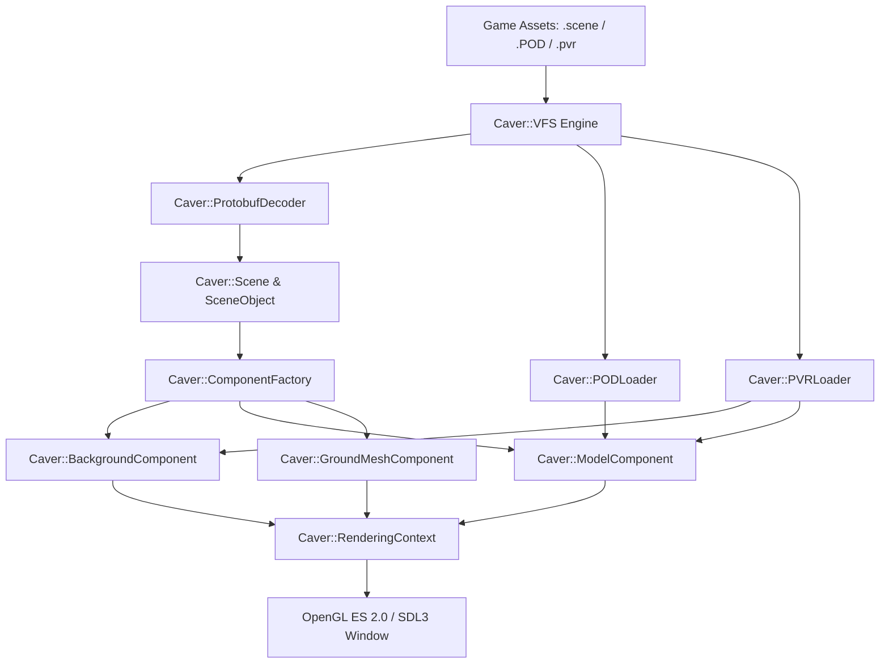

# OpenSwordigo Engine

[](LICENSE)
[](https://en.cppreference.com/w/cpp/17)
[](https://cmake.org/)
[](https://www.khronos.org/opengles/)
[](https://www.libsdl.org/)

**OpenSwordigo** is a modern, open-source C++17 reimplementation and engine reconstruction of Touch Foo's custom **Caver Engine**, the proprietary game engine powering *Swordigo*.

It provides a native engine runtime capable of parsing original binary game assets (`.scene`, `.template`, PowerVR `.POD` 3D meshes, `.pvr` compressed textures, and `.lua` scripts) and executing scene graph hierarchies, component behaviors, and GLES2-compatible rendering natively on modern platforms without relying on ARM binary translation or mobile emulators.

---

> [!IMPORTANT]
> **OpenSwordigo vs. SwordigoDesktop: Key Differences**
> - **OpenSwordigo**: A **pure native C++ open-source engine reconstruction**. Built from the ground up based on reverse-engineered Caver engine symbols and binary asset formats. It compiles natively for Linux/macOS/Windows and executes game logic and rendering independently.
> - **SwordigoDesktop**: A **binary wrapper / dynamic translation host** that executes the compiled Android/iOS ARM shared library (`libswordigo.so`) using CPU emulation (Dynarmic) or dynamic symbol hooking.

---

## Key Features

- **Native Binary Protobuf Decoder**: Zero-dependency parser for Touch Foo's custom Protocol Buffer binary format (`.scene`, `.template`), supporting variable integer wire types, nested messages, string conversions, and packed arrays.
- **Caver Scene Graph Architecture**:
  - `Caver::Scene`: Root spatial manager handling active objects, cameras, render queues, and viewport projections.
  - `Caver::SceneObject`: Reference-counted entity nodes (`Caver::ReferenceCountedObject`) maintaining local and world transformation hierarchies.
  - `Caver::ObjectTemplate`: Reusable entity prefab instantiation engine.
  - `Caver::ComponentFactory`: Dynamic registry mapping string identifier tags (`BackgroundComponent`, `ModelComponent`, `GroundMeshComponent`, `PhysicsObjectComponent`) to C++ component logic.
- **PowerVR Asset Pipeline**:
  - **PVR Texture Decoder (`Caver::PVRTCDecoder` & `Caver::PVRLoader`)**: Decompresses hardware PVRTC1 (2bpp/4bpp) and ETC1 texture streams directly to RGBA8888 for OpenGL upload.
  - **POD 3D Mesh Loader (`Caver::PODLoader`)**: Parses binary PowerVR `.POD` mesh containers, extracting vertex positions, normals, UV texture coordinates, and index buffers.
- **Graphics Pipeline (`Caver::Graphics`)**:
  - Modular OpenGL ES 2.0 / OpenGL 3.3 Core state cache and shader program abstractions (`Caver::RenderingContext`, `Caver::ShaderProgram`).
  - Native component rendering support for parallax 2D backgrounds, transformed 3D POD model meshes, terrain polygon geometry, and collision Debug overlays.
- **Scripting & Third-Party Integration**:
  - Built-in **Lua 5.1** runtime with **LuaFileSystem** (`lfs`), **LuaSocket**, and **TOML-C** configuration parsing.
- **Reverse-Engineering Suite**:
  - Includes symbol mapping databases (`caver_symbols.txt`, `caver_rtti.txt`, `swordigo_defined_symbols.txt`) and Ghidra analysis scripts for engine research.

---

## Project Structure

```
OpenSwordigo/
├── include/caver/
│   ├── components/        # Engine components (Background, Model, GroundMesh, Physics)
│   ├── graphics/          # Rendering context, PVRTC decoders, POD loaders, GLES2 shaders
│   ├── math/              # Matrix, vector, and transform math primitives
│   ├── resource/          # Virtual File System (VFS) & custom Protobuf decoder
│   └── scene/             # Scene, SceneObject, ObjectTemplate, ComponentFactory
├── src/
│   ├── components/        # Component implementations
│   ├── graphics/          # OpenGL & texture/mesh processing source code
│   ├── math/              # Math calculations & matrix transformations
│   ├── resource/          # Asset streaming & protobuf decoding
│   ├── scene/             # Scene graph logic & component instantiators
│   ├── lua/               # Embedded Lua 5.1 engine
│   ├── luafilesystem/     # LuaFileSystem module
│   ├── luasocket/         # LuaSocket networking module
│   ├── toml-c/            # Lightweight TOML parser
│   ├── main.cpp           # Headless CLI scene parser & diagnostic tool (openswordigo_native)
│   └── render_main.cpp    # SDL3 + OpenGL native window renderer (openswordigo_render)
├── ghidra_scripts/        # Reversing scripts & analysis tools
├── caver_symbols.txt      # Reconstructed Caver Engine C++ symbol table
├── caver_rtti.txt         # RTTI type descriptors & inheritance trees
└── CMakeLists.txt         # Build definition script
```

---

## Building OpenSwordigo

### Prerequisites

Ensure you have the following installed on your system:
- **C++17 Compiler** (GCC 9+, Clang 10+, or MSVC 2019+)
- **CMake** 3.14 or higher
- **SDL3** development libraries (`libsdl3-dev`)
- **OpenGL / OpenGL ES 2.0** headers and drivers
- **PkgConfig**

#### Installing Prerequisites on Linux (Ubuntu / Debian)

```bash
sudo apt update
sudo apt install build-essential cmake pkg-config libsdl3-dev libgl1-mesa-dev
```

---

### Compilation Steps

1. Configure the CMake build environment:
   ```bash
   cmake -B build -S . -DCMAKE_BUILD_TYPE=Release
   ```

2. Build all engine targets using parallel jobs:
   ```bash
   cmake --build build -j$(nproc)
   ```

Upon completion, two binary executables will be available in the `build/` directory:
- `build/openswordigo_native` (CLI Scene Parser)
- `build/openswordigo_render` (Native SDL3 OpenGL Renderer)

---

## Usage & Executables

### 1. Headless Scene Graph Parser (`openswordigo_native`)

Parse a Touch Foo binary `.scene` file headlessly to inspect its entity hierarchy, templates, and attached components:

```bash
./build/openswordigo_native path/to/town_herohouse.scene
```

### 2. Native Visual Renderer (`openswordigo_render`)

Launch the native SDL3 windowed renderer to load scene assets, upload PVR textures and POD 3D meshes to the GPU, and render the scene in real time:

```bash
./build/openswordigo_render path/to/town_herohouse.scene
```

---

## Architecture Overview



---

## Development Status & Roadmap

- [x] **Milestone 1: Core Engine Architecture & Scene Parsing**
  - Custom zero-dependency Protobuf binary asset decoder
  - `Scene`, `SceneObject`, and `ObjectTemplate` hierarchy parsing
  - Component registry & factory pattern implementation
- [x] **Milestone 2: Native Visual Rendering Pipeline**
  - SDL3 windowing & OpenGL ES 2.0 graphics context initialization
  - PVRTC1 / ETC1 texture decompression to RGBA8888
  - PowerVR `.POD` 3D mesh loader & VBO/VAO upload
  - Initial 60 FPS real-time scene rendering (`openswordigo_render`)
- [ ] **Milestone 3: Physics & Collision System**
  - Integration of `PhysicsObjectComponent` and rigid body collision solvers
  - Terrain collision polyline query engine
- [ ] **Milestone 4: Gameplay & Scripting Engine**
  - Player controller entity behaviors and movement physics
  - Full Lua 5.1 scripting lifecycle integration (`Caver::ScriptComponent`)
  - UI, HUD, sound effect trigger hooks, and level transition flow

---

## Disclaimer & Legal Notice

OpenSwordigo is an independent reverse-engineering and game engine reconstruction project created purely for educational and preservation purposes. All game content, assets, artwork, audio, and trademarks related to *Swordigo* remain the sole property of **Touch Foo**. This repository does not distribute any proprietary game assets.

---

## License

OpenSwordigo source code is distributed under the [MIT License](LICENSE).
